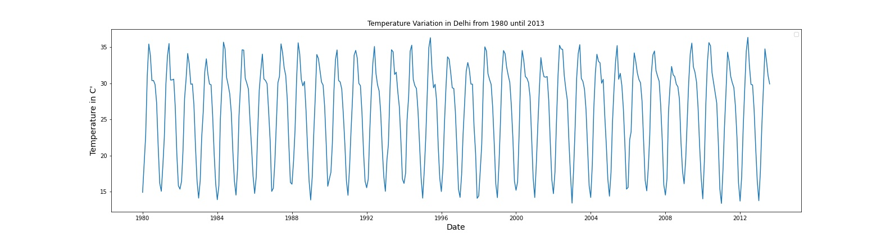
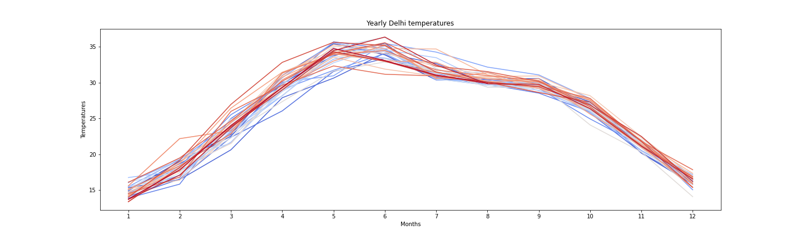
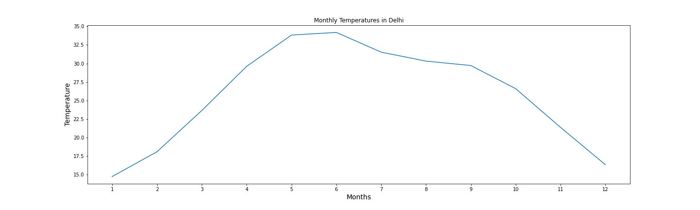
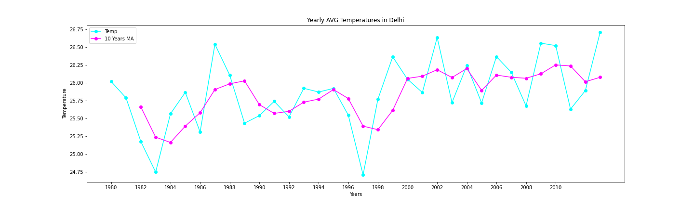
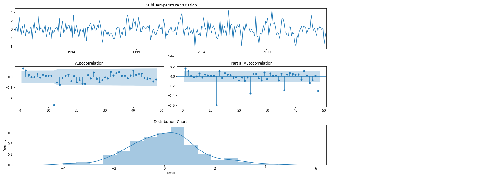
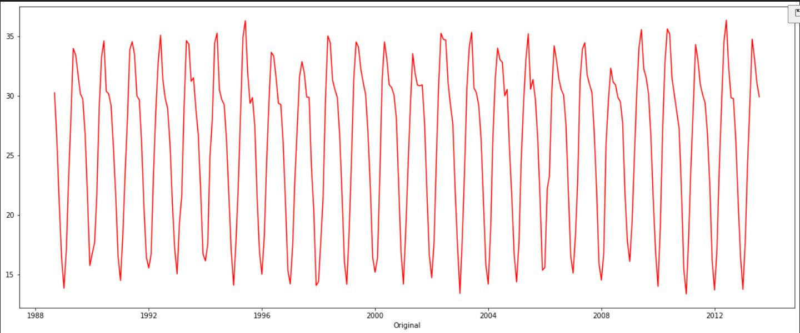
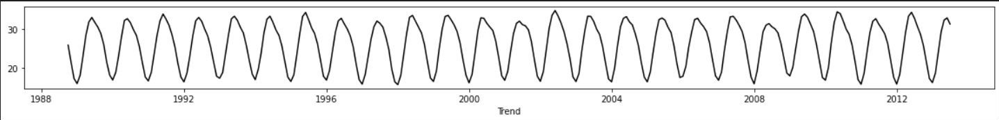
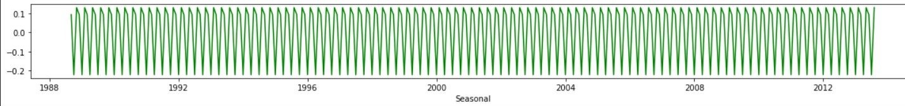
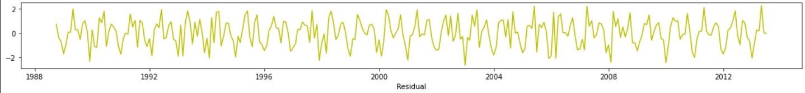
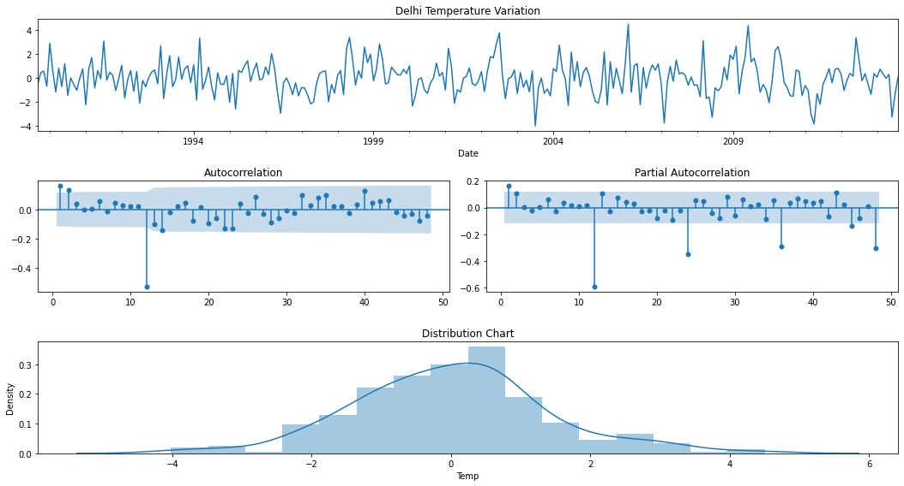

<div align="center">

# 🌍 Climate Change Analysis & Temperature Forecasting

Exploratory data analysis and time series modelling of global land temperature data (Berkeley Earth), with Delhi as a detailed case study.


</div>

---

## 📑 Table of Contents

1. [About the Project](#-about-the-project)
2. [Objectives](#-objectives)
3. [Dataset](#-dataset)
4. [Tech Stack](#-tech-stack)
5. [Project Structure](#-project-structure)
6. [Getting Started](#-getting-started)
7. [Methodology](#-methodology)
8. [Results](#-results)
9. [Interactive Dashboard](#-interactive-dashboard)
10. [Future Work](#-future-work)
11. [Author](#-author)

---

## 📖 About the Project

Climate change is the long-term shift in temperatures and typical weather patterns, either in one location or across the whole planet. It can also make weather patterns less predictable.

This project analyses the **Berkeley Earth Surface Temperature** dataset to understand how temperatures have changed over time. It walks through data cleaning, exploratory analysis, visualisation and statistical testing for time series, using **New Delhi** as a case study. The long-term goal is to build a model that can forecast temperature trends.

## 🎯 Objectives

- Clean and prepare a large, real-world temperature dataset.
- Explore long-term trends and seasonal patterns in city-level temperatures.
- Check whether the series is **stationary** using the Augmented Dickey-Fuller (ADF) test.
- Decompose the series into trend, seasonality and residuals.
- Lay the groundwork for a temperature forecasting model.

## 📊 Dataset

**Source:** [Berkeley Earth Surface Temperature Study](http://berkeleyearth.org/archive/about/) — available on [Kaggle](https://www.kaggle.com/berkeleyearth/climate-change-earth-surface-temperature-data).

The study combines **1.6 billion temperature reports from 16 archives**. It is affiliated with Lawrence Berkeley National Laboratory, and both the source data and transformation code are published. Its methods also allow shorter time series to be included, so fewer observations are discarded.

| File | Description |
|------|-------------|
| `GlobalTemperatures.csv` | Global land and land-and-ocean temperatures |
| `GlobalLandTemperaturesByCountry.csv` | Average land temperature by country |
| `GlobalLandTemperaturesByState.csv` | Average land temperature by state |
| `GlobalLandTemperaturesByMajorCity.csv` | Land temperature by major city |
| `GlobalLandTemperaturesByCity.csv` | Land temperature by city *(used in this project)* |

**Key fields in the global file**

| Field | Meaning |
|-------|---------|
| `Date` | Starts in 1750 for average land temperature; 1850 for max/min and ocean data |
| `LandAverageTemperature` | Global average land temperature (°C) |
| `LandMaxTemperature` / `LandMinTemperature` | Global average max / min land temperature (°C) |
| `LandAndOceanAverageTemperature` | Global average land and ocean temperature (°C) |
| `*Uncertainty` | 95% confidence interval around the matching value |

## 🛠 Tech Stack

- **Language:** Python 3.x
- **Libraries:** NumPy, Pandas, Matplotlib, Seaborn, Plotly, Statsmodels
- **Environment:** Jupyter Notebook, Conda
- **Dashboarding:** Tableau Public

## 📁 Project Structure

```
├── Datasets/            # Raw CSV files from Berkeley Earth
├── DataViz/
│   └── Delhi/           # Saved plots for the Delhi case study
├── Images/              # README and banner images
├── notebook.ipynb       # Main analysis notebook
└── README.md
```

> Adjust the names above to match your repository.

## 🚀 Getting Started

### 1. Clone the repository

```sh
git clone https://github.com/<your-username>/<your-repo>.git
cd <your-repo>
```

### 2. Set up the environment

**Using Conda (recommended)**

```sh
conda create -n climate python=3.10
conda activate climate
conda install numpy pandas matplotlib seaborn plotly statsmodels jupyter
```

**Using pip**

```sh
pip install numpy pandas matplotlib seaborn plotly statsmodels jupyter
```

### 3. Add the data

Download the dataset from [Kaggle](https://www.kaggle.com/berkeleyearth/climate-change-earth-surface-temperature-data) and place the CSV files in the `Datasets/` folder.

### 4. Run the notebook

```sh
jupyter notebook
```

## 🔬 Methodology

### 1. Import libraries and load data

```python
import os
import numpy as np
import pandas as pd
import matplotlib.pyplot as plt
import seaborn as sns

data = pd.read_csv(os.path.join("Datasets", "GlobalLandTemperaturesByCity.csv"))
```

### 2. Basic exploration

```python
data.info()          # data types and column names
data.describe()      # mean, std, min, quartiles, max
data.shape           # rows and columns
data.head()          # first 5 records
data.tail()          # last 5 records
data.nunique()       # unique values per column
data.isnull().sum()  # missing values per column
```

### 3. Handling missing values

The dataset contains some null values. Common strategies are to drop incomplete rows or to impute them (mean, median or most frequent value). Because the dataset is large, rows with missing values were **dropped**.

```python
data = data.dropna(how="any", axis=0)
```

### 4. Preparing the time series

```python
data["Date"] = pd.to_datetime(data["Date"])
data = data.set_index("Date")
data["Year"] = data.index.year
data["Month"] = data.index.month
```

### 5. Case study: New Delhi

```python
delhi = data.loc[data["City"] == "New Delhi", ["AverageTemperature", "Year", "Month"]]
delhi = delhi.rename(columns={"AverageTemperature": "Temp"})
```

**Temperature variation, 1980 – 2013**

```python
plt.figure(figsize=(22, 6))
sns.lineplot(x=delhi.index, y=delhi["Temp"])
plt.title("Temperature Variation in Delhi (1980–2013)")
plt.xlabel("Date", fontsize=14)
plt.ylabel("Temperature (°C)", fontsize=14)
plt.savefig("DataViz/Delhi/1980-2013Temp.jpeg")
plt.show()
```



**Month-by-year pivot table**

```python
pivot = pd.pivot_table(delhi, values="Temp", index="Month", columns="Year", aggfunc="mean")
pivot.plot(figsize=(20, 6), colormap="coolwarm", legend=False)
plt.title("Yearly Delhi Temperatures")
plt.xlabel("Month")
plt.ylabel("Temperature (°C)")
plt.xticks(range(1, 13))
plt.savefig("DataViz/Delhi/TemperatureChangeDelhi.png")
plt.show()
```



Temperatures clearly **peak in May–July** and **fall in November–December**.

**Average monthly seasonality**

```python
pivot.mean(axis=1).plot(figsize=(20, 6))
plt.title("Average Monthly Temperatures in Delhi")
plt.xlabel("Month", fontsize=14)
plt.ylabel("Temperature (°C)", fontsize=14)
plt.xticks(range(1, 13))
plt.savefig("DataViz/Delhi/AvgTempChangeMonth.png")
plt.show()
```



**Yearly average with rolling mean**

```python
year_avg = pd.pivot_table(delhi, values="Temp", index="Year", aggfunc="mean")
year_avg["3-Year MA"] = year_avg["Temp"].rolling(3).mean()

year_avg[["Temp", "3-Year MA"]].plot(figsize=(20, 6), colormap="cool", marker="o")
plt.title("Yearly Average Temperature in Delhi")
plt.xlabel("Year")
plt.ylabel("Temperature (°C)")
plt.savefig("DataViz/Delhi/TempChangeVsRollingMean.png")
plt.show()
```



### 6. Train / validation / test split

Time series data is ordered, so it must **not** be shuffled. The split is done chronologically by slicing.

```python
n = len(delhi)
train_end = int(n * 0.7)
val_end = int(n * 0.85)

df_train = delhi.iloc[:train_end]
df_val = delhi.iloc[train_end:val_end]
df_test = delhi.iloc[val_end:]
```

### 7. Stationarity check: Augmented Dickey-Fuller (ADF) test

The ADF test is a statistical unit root test.

- **Null hypothesis (H₀):** the series is non-stationary.
- If the **test statistic is lower than the critical value**, H₀ is rejected and the series can be treated as stationary.
- A **low p-value** (typically < 0.05) also supports stationarity.

```python
from statsmodels.tsa.stattools import adfuller

result = adfuller(df_train["Temp"].values, autolag="AIC")

output = pd.Series(result[0:4],
                   index=["Test Statistic", "p-value", "Lags Used", "Observations Used"])
for key, value in result[4].items():
    output[f"Critical Value ({key})"] = value

print(output)
```

### 8. Diagnostic plots

```python
from math import sqrt
from statsmodels.graphics.tsaplots import plot_acf, plot_pacf
from statsmodels.tsa.stattools import adfuller

def check_stationarity(y, lags_plots=48, figsize=(22, 8)):
    y = pd.Series(y)
    fig = plt.figure(figsize=figsize)

    ax1 = plt.subplot2grid((3, 3), (0, 0), colspan=2)
    ax2 = plt.subplot2grid((3, 3), (1, 0))
    ax3 = plt.subplot2grid((3, 3), (1, 1))
    ax4 = plt.subplot2grid((3, 3), (2, 0), colspan=2)

    y.plot(ax=ax1)
    ax1.set_title("Delhi Temperature Variation")
    plot_acf(y, lags=lags_plots, zero=False, ax=ax2)
    plot_pacf(y, lags=lags_plots, zero=False, ax=ax3)
    sns.histplot(y, bins=int(sqrt(len(y))), kde=True, ax=ax4)
    ax4.set_title("Distribution")

    plt.tight_layout()
    plt.savefig("DataViz/Delhi/AdfullerTest.png")

    stat, pvalue, lags, nobs, crit, _ = adfuller(y)
    print("Results of Dickey-Fuller Test")
    print(f"Test Statistic: {stat:.4f}")
    print(f"p-value:        {pvalue:.4f}")
    print(f"Lags Used:      {lags}")
    print(f"Observations:   {nobs}")
    for key, value in crit.items():
        print(f"Critical Value ({key}): {value:.4f}")

    if stat < crit["5%"]:
        print("\nTest statistic is below the 5% critical value: the series seems stationary.")
    else:
        print("\nTest statistic is above the 5% critical value: the series is not stationary.")

check_stationarity(df_train["Temp"])
```



### 9. Seasonal decomposition

```python
from statsmodels.tsa.seasonal import seasonal_decompose

decomp = seasonal_decompose(df_train["Temp"], period=12)  # 12 = monthly data, yearly cycle
decomp.plot()
plt.show()
```

| Original | Trend | Seasonal | Residual |
|:---:|:---:|:---:|:---:|
|  |  |  |  |

### 10. Differencing

`DataFrame.diff(periods)` computes the discrete difference between observations. A seasonal difference of 12 months removes the yearly cycle.

```python
check_stationarity(df_train["Temp"].diff(12).dropna())
```



## 📈 Results

| Series | Test Statistic | p-value | 5% Critical Value | Conclusion |
|--------|:---:|:---:|:---:|-----------|
| Original (train) | -3.3408 | 0.0132 | -2.8717 | Stationary at 5% |
| Seasonally differenced (lag 12) | -6.4568 | 0.0000 | -2.8721 | Stationary (stronger) |

**Key findings**

- Delhi shows a strong, regular **seasonal cycle**, with peaks in May–July and lows in November–December.
- Both the original and the seasonally differenced series pass the ADF test at the 5% level, with the differenced series far more clearly.
- The yearly average and its rolling mean make the long-term trend easier to see.


## 👤 Author

**Your Name**
[GitHub](https://github.com/ravine27) · [LinkedIn](https://www.linkedin.com/in/radha-agarwal-67b925289/) · radhaagrwal.380@gmail.com

---

⭐ If you found this project useful, consider giving it a star!

## 🙏 Acknowledgements

- [Berkeley Earth](http://berkeleyearth.org/) for the open temperature data.
- [Kaggle](https://www.kaggle.com/) for hosting the dataset.
